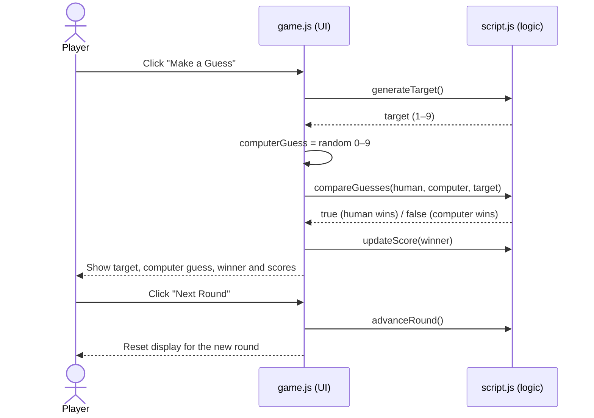

# Number Guesser

A small browser game where you play against the computer. Each round a secret target number between 1 and 9 is drawn; you and the computer each guess a number between 0 and 9, and whoever is closest to the target wins the round. Live demo: <https://hevolx.github.io/numberGuesser/>

## Motivation

I built this project to practice JavaScript as part of the Codecademy Full-Stack Engineer career path. It is off-project training: a small guessing game where I write the functions that power the game logic.

## Features

- Play rounds against a computer opponent that guesses randomly (0–9)
- A new random target (1–9) is drawn each round
- Closest guess wins; exact matches win outright, and ties go to the human player
- Running score for both you and the computer
- Round counter and "Next Round" flow
- Number input with `+` / `-` controls, limited to 0–9
- Instructions displayed below the game

## Tech/framework used

**Built with:**

- HTML5
- CSS3 ([style.css](style.css))
- Vanilla JavaScript (no frameworks or build step)
- [Google Fonts](https://fonts.google.com/) (Nunito Sans)
- Hosted on GitHub Pages

## Sequence diagram / UML



## Code style

No linter, formatter or EditorConfig is configured. The code is plain JavaScript split into game logic ([script.js](script.js)) and DOM handling ([game.js](game.js)).

## Installation

There are no dependencies or build steps.

1. Clone the repository:
   ```bash
   git clone https://github.com/hevolx/numberGuesser.git
   cd numberGuesser
   ```
2. Open `index.html` in your browser, or serve the folder locally:
   ```bash
   python3 -m http.server 8000
   ```
   Then visit <http://localhost:8000>.

## Usage examples

1. Open the game (locally or at <https://hevolx.github.io/numberGuesser/>).
2. Enter a number between 0 and 9, using the input field or the `+` / `-` buttons.
3. Click **Make a Guess**. The target number and the computer's guess are revealed, and the winner is shown.
4. Click **Next Round** to reset the board and play again. Scores carry over between rounds.

Example: target is 6, you guess 5 and the computer guesses 8. Your distance is 1 and the computer's is 2, so you win the round.